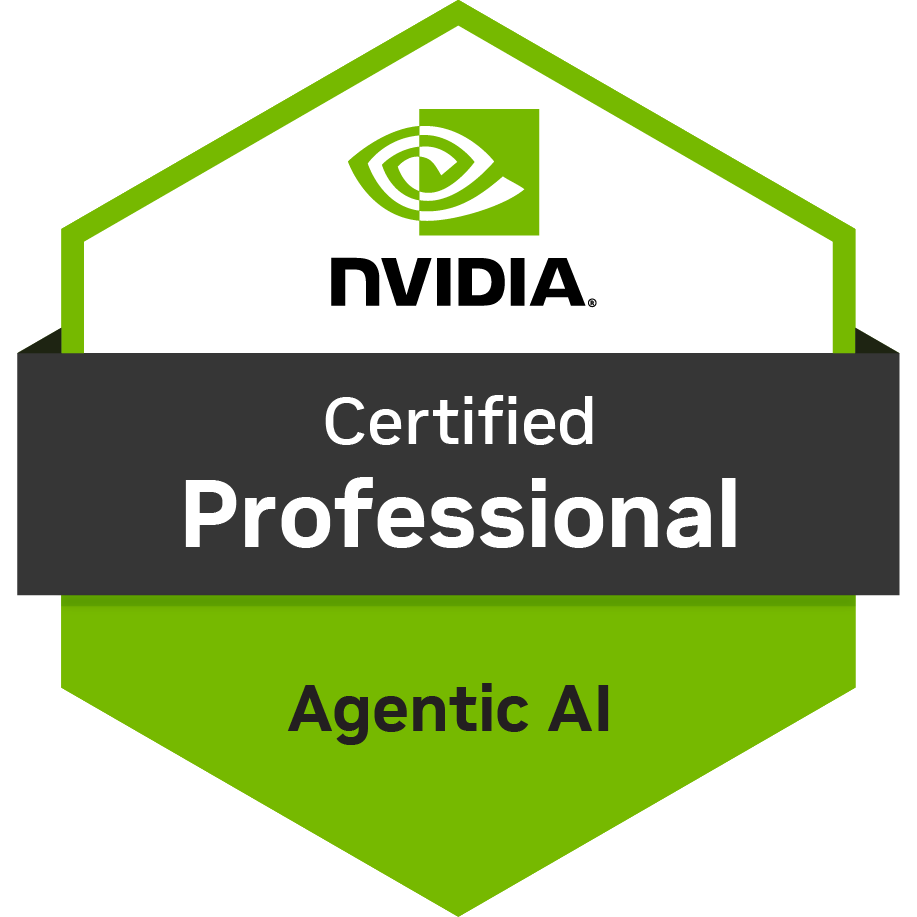

<h1>Syed Muzakkir Hussain</h1>

<h3>Senior AI Software Engineer</h3>

I take AI from pilot to production: agentic systems, LLM and ML applications, and the backend and
data platforms that keep them reliable, observable and cost-efficient at scale.

<b>Agentic AI · LLMs and RAG · Evals and Observability · Machine Learning · Backend Systems · Data Engineering · Cloud and MLOps</b>

 

&nbsp;&nbsp;
&nbsp;&nbsp;

 

 

<h3>Certifications</h3>

<table>
  <tr>
    <td align="center" valign="top" width="200">
      
       <b>NVIDIA</b> Agentic AI Professional
    </td>
    <td align="center" valign="top" width="200">
      
       <b>Microsoft</b> Azure AI Apps and Agents
    </td>
    <td align="center" valign="top" width="200">
      
       <b>Microsoft</b> Azure Data Scientist
    </td>
    <td align="center" valign="top" width="200">
      
       <b>Google</b> TensorFlow Developer
    </td>
  </tr>
</table>

